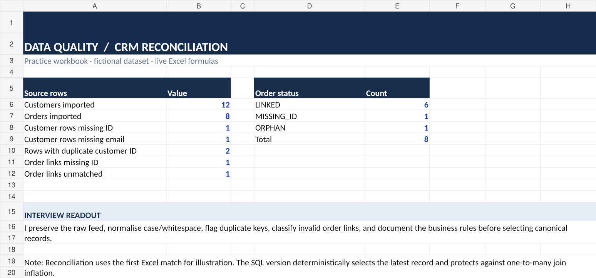

# CRM Data Quality & SQL Reconciliation

[](https://github.com/eskooo-a2fi/sql-data-quality/actions/workflows/ci.yml)

**An auditable data-quality case study** using fictional customer and order records with duplicate IDs, missing emails, invalid foreign keys and inconsistent formatting. The workflow profiles defects, classifies reconciliation issues, selects canonical records with CTEs, and asserts expected outcomes.



## Scenario and results

A CRM import includes **12 customer rows and 8 order rows**, intentionally containing inconsistent fields. The companion Excel workbook is an illustrative calculation dashboard; the PostgreSQL scripts run independently.

| Business question | Approach | Interview value |
| --- | --- | --- |
| Which customers are duplicated? | Normalised keys and window counts | Detect both repeated IDs and email-based duplicates |
| Which orders cannot link to customers? | `NOT EXISTS` and separate reasons | Distinguish NULL IDs from invalid IDs |
| Can orders be reconciled without double-counting? | Canonical customer CTE plus `LEFT JOIN` | Prevent one-to-many inflation |
| Which customers should be retained? | Validity checks and deterministic CTE ranking | Explain business rules and tie-breaking |
| How do we know the result stays stable? | Assertion SQL and GitHub Actions | Make quality standards repeatable |

## Reproduce the analysis

Use PostgreSQL 15+ in a **disposable database**. **The first script drops and recreates the `dq_portfolio` schema**; do not run it on production data.

```bash
createdb dq_portfolio_demo
psql -X -v ON_ERROR_STOP=1 -d dq_portfolio_demo -f sql/01_seed_messy_data.sql
psql -X -v ON_ERROR_STOP=1 -d dq_portfolio_demo -f sql/02_identify_duplicates.sql
psql -X -v ON_ERROR_STOP=1 -d dq_portfolio_demo -f sql/03_find_orphaned_orders.sql
psql -X -v ON_ERROR_STOP=1 -d dq_portfolio_demo -f sql/04_reconcile_with_left_join.sql
psql -X -v ON_ERROR_STOP=1 -d dq_portfolio_demo -f sql/05_clean_customers_cte.sql
psql -X -v ON_ERROR_STOP=1 -d dq_portfolio_demo -f sql/06_quality_assertions.sql
```

See the [formula-driven Excel workbook](data_quality_review.xlsx) for a separate quality-register and KPI dashboard. It uses fabricated records only.

## Script-by-script interview guide

| SQL file | Why it matters |
| --- | --- |
| [`01_seed_messy_data.sql`](sql/01_seed_messy_data.sql) | Preserve defects in staging rather than silently fixing the source |
| [`02_identify_duplicates.sql`](sql/02_identify_duplicates.sql) | Case/space normalisation before duplicate detection |
| [`03_find_orphaned_orders.sql`](sql/03_find_orphaned_orders.sql) | Separate missing customer IDs from unmatched non-null IDs |
| [`04_reconcile_with_left_join.sql`](sql/04_reconcile_with_left_join.sql) | Dedupe the customer dimension before joining orders |
| [`05_clean_customers_cte.sql`](sql/05_clean_customers_cte.sql) | Explain standardise → validate → choose one per ID → choose one per email |
| [`06_quality_assertions.sql`](sql/06_quality_assertions.sql) | Test fixture assumptions and outcome counts in PostgreSQL |

## Data governance limitations

Email alone is not a reliable real-world identity key, and this deliberately simplified matching logic would require a business-approved policy, exception queue, source-of-truth controls and an ID crosswalk before CRM updates. The fixture's six canonical customers are **not** an instruction to delete production records. The email regex is heuristic, not proof that an address exists or that marketing consent was obtained.
